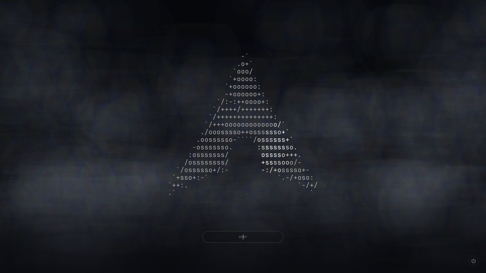
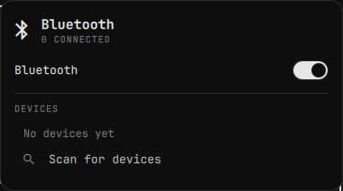
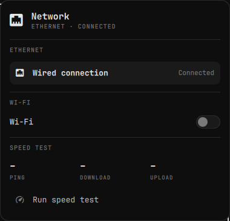

<div align="center">

# paleOS

**A clean, monochrome Arch Linux + Hyprland setup.**
Just the OS layer: login screen, bar, panels, menu, workspaces and keybinds. You add the apps.



</div>

## Look


<table>
  <tr>
    <td></td>
    <td><br></td>
    <td><br></td>
  </tr>
</table>

## What's in it

- **Login screen** — animated Arch logo over a night sky, password at the bottom, power menu in the corner
- **Top bar** — workspaces, clock, tray, and one icon each for sound, network, bluetooth and display
- **Panels** — volume and output picker, Wi-Fi and speed test, Bluetooth devices, display scale and night light
- **Menu** (`SUPER + SPACE`) — Apps, Learn, Trigger, Style, Display, Setup, Install, Remove, Update, About, System.
  Type to search apps; `=` calculator, `:` emoji, anything else searches the web
- **Lock screen, screensaver and boot splash** — matching black and white
- **Gaming-ready defaults** — GameMode, FreeSync in fullscreen, low-latency tearing for games

## Install

On a fresh Arch install with Hyprland (e.g. `archinstall` → Desktop → Hyprland):

```bash
curl -fsSL https://raw.githubusercontent.com/Bettencourtzw/paleOS/main/boot.sh | bash
```

or

```bash
git clone https://github.com/Bettencourtzw/paleOS && cd paleOS && ./install.sh
```

The installer asks before it does anything big. It does **not** force a system update, and it backs up any config it replaces to `~/.config/paleos-backup-<date>`. Reboot when it's done.

## Keys

| Keys | Action |
|---|---|
| `SUPER + SPACE` | Menu and app search |
| `SUPER + RETURN` | Terminal |
| `SUPER + W` | Close window |
| `SUPER + 1 … 0` | Switch workspace |
| `SUPER + SHIFT + 1 … 0` | Move window to workspace |
| `SUPER + SHIFT + S` | Screenshot to clipboard |
| `SUPER + ESC` | System menu |
| `SUPER + CTRL + L` | Lock |
| `SUPER + K` | Show every keybinding |

## Make it yours

| Change | File |
|---|---|
| Bar | `~/.config/waybar/` (`colors.css`, `config.jsonc`, `style.css`) |
| Menu entries | `~/.local/bin/menu` |
| Menu colors | `~/.config/rofi/colors.rasi` |
| Panel colors | `~/.config/quickshell/Theme.qml` |
| Keybindings | `~/.config/hypr/bindings.lua` |
| Monitor | `~/.config/hypr/monitors.lua` |

## Credits

Inspired by [Omarchy](https://github.com/basecamp/omarchy). MIT licensed.
