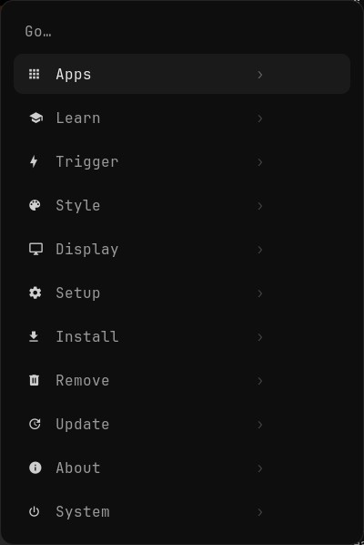
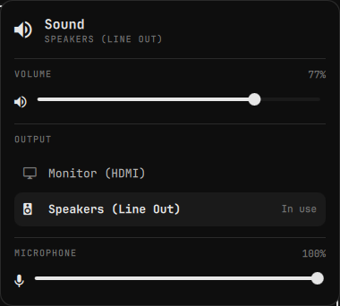
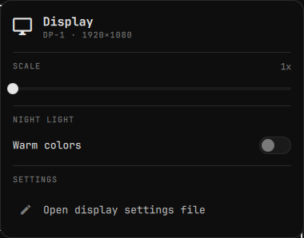

# paleOS

**Arch Linux, made calm.**

paleOS is Arch Linux with a quiet, black-and-white desktop on top. You get Arch as it is —
rolling, fast, nothing hidden — plus the things you'd otherwise spend a weekend setting up:
a login screen, a top bar, click-to-open panels, an app menu, sensible keybindings, a lock
screen and a screensaver. It's inspired by [Omarchy](https://github.com/basecamp/omarchy),
but it ships only the OS layer. The apps are up to you.

Install it from the **paleOS ISO** (a guided installer: pick your kernel, disk,
encryption and extras) or put it on an **existing Arch install** with one command.

<table><tr>
  <td></td>
  <td> </td>
  <td> </td>
</tr></table>

## Documentation

| | |
|---|---|
| [Install](docs/install.md) | From the ISO, or on top of an Arch install you already have |
| [Using paleOS](docs/using.md) | Menu, panels, keybindings, screenshots, gaming |
| [Make it yours](docs/customize.md) | The Customize app, colors, bar, menu entries, keys, monitors |
| [Privacy & security](docs/security.md) | Encrypted DNS with no leaks, firewall, hardening |
| [How it's built](docs/architecture.md) | What lives where, and how the pieces fit |
| [Building the ISO](docs/iso.md) | Make your own installer image |

MIT licensed.
