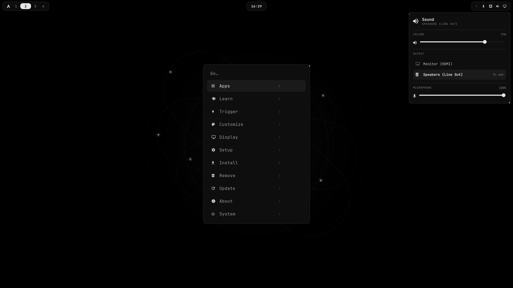

<div align="center">

# paleOS

**Arch Linux, without the setup.**


</div>

Arch is fast, current and yours, but a fresh install is a blank screen and a weekend of
configuring. paleOS does that weekend for you, then gets out of the way.

You get a calm, black-and-white desktop where everything has one obvious place:

- **One key for everything.** `SUPER + SPACE` opens the menu: your apps, settings, installing
  software, power. Start typing to find any app.
- **One click for the basics.** Sound, Wi-Fi, Bluetooth and display each have an icon in the
  top bar. Click it, change it, click away.
- **No config files to learn.** Background, window style, power and idle settings are in
  Customize and Power settings, and every change applies the moment you click. The text files
  are still there if you want them.
- **Install apps without knowing package names.** Browsers, editors, dev tools and web apps
  come as short lists. Pick one and it's installed.
- **Keys that make sense.** Close, fullscreen, move windows and switch workspaces with a few
  keys you'll remember. `SUPER + K` lists them all.
- **Safe by default.** Encrypted DNS with no leaks, a firewall, and nothing that phones home.
- **Ready for code.** Editors and dev servers get the limits they need.

Underneath it's plain Arch with Hyprland: same packages, same wiki, nothing hidden. paleOS adds
the desktop, not the apps. You choose those.

<div align="center">



</div>

## Install

Boot the **paleOS ISO** and answer a few questions: disk, keyboard, account. Or add paleOS to an
Arch install you already have:

```bash
curl -fsSL https://raw.githubusercontent.com/Bettencourtzw/paleOS/main/boot.sh | bash
```

It never forces a system update, and it backs up anything it replaces.

## Learn more

| | |
|---|---|
| [Install](docs/install.md) | From the ISO, or on top of Arch |
| [Using paleOS](docs/using.md) | The menu, panels, keys, customizing, power |
| [Make it yours](docs/customize.md) | Every setting and the file behind it |
| [Privacy & security](docs/security.md) | Encrypted DNS, firewall, hardening |
| [How it's built](docs/architecture.md) | What lives where |
| [Building the ISO](docs/iso.md) | Make your own installer image |

Inspired by [Omarchy](https://github.com/basecamp/omarchy). MIT licensed.
